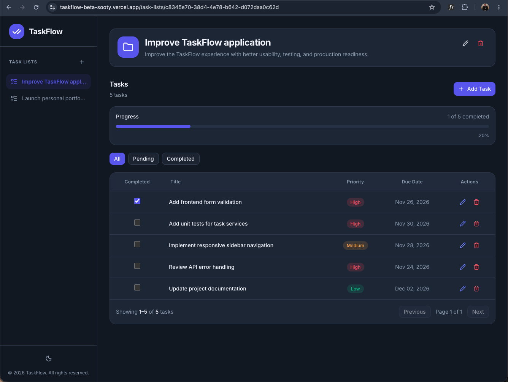

# TaskFlow

A full-stack task management application built with **Spring Boot, Vue 3, TypeScript, and PostgreSQL**.

TaskFlow helps users organize their work through task lists and individual tasks, with priorities, due dates, status tracking, and progress monitoring.

## Live Demo

**Try TaskFlow:** [Open Live Demo](https://taskflow-beta-sooty.vercel.app/)

## Screenshots

### Task Management



## Features

### Task Lists
- Create, edit, and delete task lists.
- Navigate between task lists using the sidebar.
- Display the number of tasks in each list.
- View task list details and progress.

### Tasks
- Create, edit, and delete tasks.
- Assign priorities: Low, Medium, and High.
- Set due dates.
- Track task completion status.
- Filter tasks by status (Open and Closed).
- Paginate task results directly through the backend.

### User Interface
- Light and dark themes.
- Form validation and error handling.
- Loading and empty states.
- Confirmation dialogs for destructive actions.
- Responsive interface (in progress).

## Tech Stack

### Backend
- Java
- Spring Boot
- Spring Data JPA
- Hibernate
- PostgreSQL
- Flyway

### Frontend
- Vue 3
- TypeScript
- Vite
- Vue Router
- Pinia
- TanStack Vue Query
- Tailwind CSS
- shadcn-vue
- Axios
- VeeValidate
- Zod

### Development & Testing
- Maven
- pnpm
- Docker Compose
- Vitest
- Vue Test Utils
- Playwright

## Architecture

TaskFlow follows a frontend/backend separation within a monorepo structure.

```text
taskflow/
├── backend/                  # Spring Boot REST API
├── frontend/                 # Vue 3 application
├── docker-compose.yml        # Local PostgreSQL container
├── .env.example              # Environment variable template
├── .gitignore
└── README.md
```

### Application Flow

```text
Vue 3 Frontend
      |
      | HTTP / REST API
      v
Spring Boot Backend
      |
      | Spring Data JPA
      v
PostgreSQL Database
```

The frontend communicates with the backend through REST endpoints. The backend handles business logic, persistence, pagination, filtering, and database interactions.

## Getting Started

### Prerequisites

Make sure you have the following installed:

- Java (version required by the backend project)
- Maven
- Node.js
- pnpm
- Docker and Docker Compose

### 1. Clone the repository

```bash
git clone https://github.com/dev-madepozo/taskflow.git
cd taskflow
```

### 2. Configure environment variables

Create your local environment file:

```bash
cp .env.example .env
```

Update the database credentials in `.env`:

```env
DB_NAME=taskflow
DB_USER=taskflow_user
DB_PASSWORD=your-local-password
```

Never commit your actual `.env` file.

### 3. Start PostgreSQL

From the project root:

```bash
docker compose up -d
```

Check the container status:

```bash
docker compose ps
```

### 4. Start the backend

Make sure the database environment variables are available to the Spring Boot process, then run:

```bash
cd backend
mvn spring-boot:run
```

The API uses the backend server's configured port.

### 5. Start the frontend

Open another terminal:

```bash
cd frontend
pnpm install
pnpm dev
```

Vite will display the local frontend URL in the terminal.

## API Overview

### Task Lists

| Method | Endpoint | Description |
|---|---|---|
| GET | `/task-lists` | Retrieve all task lists |
| GET | `/task-lists/{id}` | Retrieve a task list |
| POST | `/task-lists` | Create a task list |
| PUT | `/task-lists/{id}` | Update a task list |
| DELETE | `/task-lists/{id}` | Delete a task list |

### Tasks

| Method | Endpoint | Description |
|---|---|---|
| GET | `/task-lists/{taskListId}/tasks` | Retrieve paginated tasks |
| POST | `/task-lists/{taskListId}/tasks` | Create a task |
| PUT | `/task-lists/{taskListId}/tasks/{taskId}` | Update a task |
| DELETE | `/task-lists/{taskListId}/tasks/{taskId}` | Delete a task |

The task listing endpoint supports pagination and optional status filtering:

```http
GET /task-lists/{taskListId}/tasks?page=0&size=10
GET